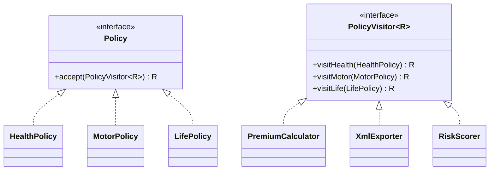

**Intent:** represent an **operation** to be performed on the elements of an object structure as a separate object, letting you **add new operations without changing the classes** of the elements.

Visitor is the most complex GoF pattern and comes up less often in machine coding, but interviewers use it to test understanding of **double dispatch** and the **expression problem**.

## The problem

An insurance system models a portfolio of different policy types: `HealthPolicy`, `MotorPolicy`, `LifePolicy`. You need operations across all of them: calculate premium, export to XML, compute risk score, generate a regulatory report… and the list keeps growing.

- Adding each operation as a method on every policy class bloats the domain classes with unrelated concerns (XML export inside `MotorPolicy`?) and requires editing all of them for every new operation.
- Writing operations outside with `instanceof` chains loses type safety and silently misses new policy types.

## The solution: double dispatch

Each element gets a single generic method, `accept(visitor)`, that calls back the visitor method **for its own concrete type**. Each operation becomes a **visitor** class with one method per element type.



```java
public interface PolicyVisitor<R> {
    R visitHealth(HealthPolicy p);
    R visitMotor(MotorPolicy p);
    R visitLife(LifePolicy p);
}

public interface Policy {
    <R> R accept(PolicyVisitor<R> visitor);
}

public record MotorPolicy(String id, int vehicleAge, int claimsLast3Years) implements Policy {
    public <R> R accept(PolicyVisitor<R> v) { return v.visitMotor(this); }     // dispatch #2
}
public record HealthPolicy(String id, int insuredAge, boolean smoker) implements Policy {
    public <R> R accept(PolicyVisitor<R> v) { return v.visitHealth(this); }
}

// A new operation = a new visitor; the policy classes don't change
public final class PremiumCalculator implements PolicyVisitor<Money> {
    public Money visitHealth(HealthPolicy p) { return Money.of(p.smoker() ? 18_000 : 12_000); }
    public Money visitMotor(MotorPolicy p)   { return Money.of(6_000 + 1_500L * p.claimsLast3Years()); }
    public Money visitLife(LifePolicy p)     { return Money.of(9_000); }
}

Money total = portfolio.stream()
        .map(p -> p.accept(new PremiumCalculator()))          // dispatch #1 on the element's runtime type
        .reduce(Money.ZERO, Money::plus);
```

Why "double dispatch": Java dispatches method calls on the runtime type of **one** object (the receiver). `policy.accept(visitor)` selects the right `accept` by the **element's** type; inside it, `v.visitMotor(this)` selects the right implementation by the **visitor's** type. Two dynamic dispatches together pick the method for the *(element type, operation)* pair.

## The trade-off: the expression problem

| You want to add… | Without Visitor (methods on elements) | With Visitor |
| --- | --- | --- |
| A new **operation** | Edit every element class | Add one visitor class ✅ |
| A new **element type** | Add one class ✅ | Edit every visitor (new `visitX` method) |

So Visitor fits when the **element hierarchy is stable** but **operations keep growing** — compilers (AST nodes are fixed; analyses and optimisations keep coming), document models, reporting over a fixed domain model.

## Modern Java alternative: sealed types + pattern matching

Java 17+ sealed interfaces and Java 21 pattern matching for `switch` give an exhaustive, type-safe alternative without the `accept` boilerplate:

```java
public sealed interface Policy permits HealthPolicy, MotorPolicy, LifePolicy { }

static Money premium(Policy p) {
    return switch (p) {                         // compiler checks exhaustiveness
        case HealthPolicy h -> Money.of(h.smoker() ? 18_000 : 12_000);
        case MotorPolicy m  -> Money.of(6_000 + 1_500L * m.claimsLast3Years());
        case LifePolicy l   -> Money.of(9_000);
    };
}
```

Adding a new permitted subtype makes every non-exhaustive `switch` a **compile error** — the same safety Visitor gives, with less ceremony. Mentioning this shows you know where the language has moved.

## Where you've seen it

- `java.nio.file.FileVisitor` / `Files.walkFileTree` — visit files and directories with different callbacks.
- `javax.lang.model.element.ElementVisitor` (annotation processing), compiler ASTs (javac, Eclipse JDT, ANTLR parse-tree visitors).
- Document/object-model exporters that render the same structure to HTML, PDF and plain text.

## Pros and cons

| Pros | Cons |
| --- | --- |
| Add operations without touching element classes (OCP for operations) | Adding a new element type forces changes to every visitor |
| Each operation's logic is in one class (SRP); visitors can accumulate state across a traversal | Visitors may need access to element internals, weakening encapsulation |
| Type-safe alternative to `instanceof` chains | Boilerplate `accept` methods; harder to understand |

## Related patterns

- Visitor + **Composite**: apply an operation over a whole tree (each composite's `accept` visits its children).
- Visitor + **Iterator**: iterate a heterogeneous structure and apply a visitor to each element.
- Visitor is like a more powerful **Command** that can operate on objects of different classes.

## Interview questions

<QA q="What is double dispatch and why does Visitor need it?">
Java chooses which overridden method to run based on the runtime type of the receiver only (single dispatch); overload resolution uses static argument types. Visitor needs the behaviour to depend on two runtime types — the element and the operation. The element's accept method (dispatched on the element type) calls the visitor's type-specific method, which is then dispatched on the visitor's type, achieving the combination.
</QA>

<QA q="When is Visitor a bad choice?">
When the element hierarchy changes often, because every new element type requires a new method in the visitor interface and every visitor implementation. Also when there are only a couple of operations, or when the operations need deep access to element internals. In modern Java, sealed interfaces with pattern-matching switch are often simpler.
</QA>

<Practice task="An expression tree has Number, Add, Multiply and Variable nodes. You need evaluate, pretty-print and simplify. Visitor, or sealed types with pattern matching — choose and justify.">

The node set is small and stable while operations keep growing — both approaches handle that. On Java 21, a sealed `Expr` interface with records and an exhaustive `switch` is simpler: no `accept` boilerplate, and adding a node type turns every non-exhaustive switch into a compile error. Choose the classic Visitor on older Java versions, when double dispatch must cross a library boundary, or when visitors accumulate state across a traversal in a framework-style API.

</Practice>

<Takeaways>

- Visitor separates operations from a stable hierarchy of element classes.
- Double dispatch (accept → visitX) selects behaviour by both element and operation type.
- Easy to add operations, hard to add element types — the expression problem.
- Sealed types with pattern matching are a modern Java alternative.

</Takeaways>

## Further reading

- Gamma et al., *Design Patterns* (1994) — Visitor.
- JEP 409 (Sealed Classes) and JEP 441 (Pattern Matching for switch).
- Alexander Shvets, *Dive Into Design Patterns* — "Visitor".
